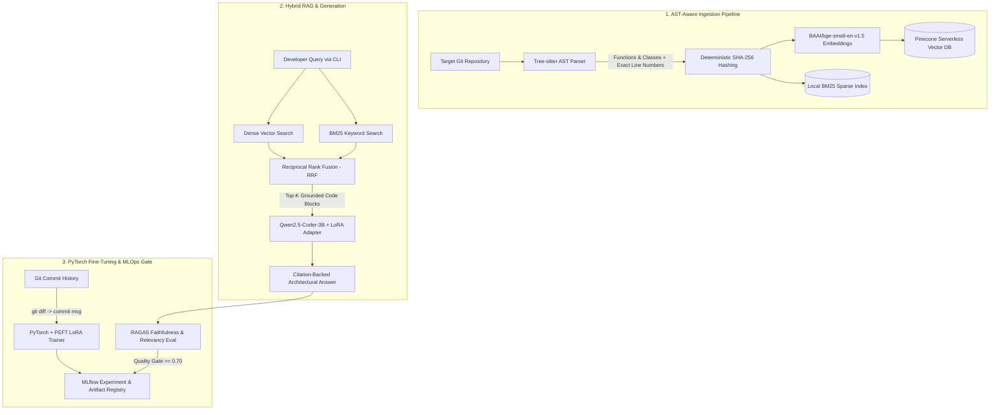

# Repo-Architect: Autonomous Codebase Onboarding & Architecture Assistant

[](https://github.com/VenuR0071/repo-architect/actions/workflows/eval_pipeline.yml)
[](https://www.python.org/downloads/)
[](https://pytorch.org/)
[](https://opensource.org/licenses/MIT)

**Repo-Architect** is a self-hosted developer productivity CLI and GenAI pipeline that ingests Git repositories, parses Abstract Syntax Trees (AST) into semantic code blocks, indexes them into a hybrid retrieval engine (Pinecone + BM25), and serves grounded architectural Q&A and automated commit/PR summaries powered by a PyTorch LoRA fine-tuned LLM.

---

## System Architecture



---

## Key Engineering Highlights

* **AST-Aware Chunking (Tree-sitter):** Eliminates arbitrary token splitting that breaks functions mid-logic. Extracts complete classes, methods, and functions across Python, Java, and JavaScript with exact file paths and line numbers.
* **Hybrid Search with Reciprocal Rank Fusion (RRF):** Combines dense semantic search (`Pinecone` + `BAAI/bge-small-en-v1.5`) with exact keyword matching (`BM25Okapi`) so queries referencing specific function names (`verify_jwt_token`) or broad architectural concepts resolve accurately.
* **Idempotent Vector Indexing:** Generates deterministic SHA-256 content hashes for every AST block, preventing duplicate vectors across incremental re-indexing runs.
* **PyTorch + PEFT LoRA Fine-Tuning:** Includes an automated dataset extraction pipeline (`git diff` $\rightarrow$ commit summary) and QLoRA/LoRA fine-tuning loop logged end-to-end in **MLflow**.
* **Automated MLOps Quality Gates:** Evaluates retrieval faithfulness and answer relevancy using **RAGAS** and runs unit tests on every push via **GitHub Actions**.

---

## Quickstart (Windows 11 & Linux)

### 1. Clone & Configure Environment
```bash
git clone https://github.com/YOUR_USERNAME/repo-architect.git
cd repo-architect

python -m venv .venv
# Windows PowerShell:
.\.venv\Scripts\Activate.ps1
# Linux/macOS:
# source .venv/bin/activate

pip install --upgrade pip
pip install -e .
```

### 2. Set Environment Variables
Create a `.env` file in the root directory:
```env
PINECONE_API_KEY=your_pinecone_api_key
PINECONE_INDEX_NAME=repo-architect
LLM_MODEL_ID=Qwen/Qwen2.5-Coder-3B-Instruct
MLFLOW_TRACKING_URI=http://localhost:5000
```

### 3. Ingest & Query a Codebase
```bash
# Parse AST blocks and upsert to Pinecone + local BM25 cache
repo-arch ingest . --repo-id self-demo

# Ask an architectural question with exact file & line citations
repo-arch ask "How does HybridCodeRetriever fuse dense and sparse search results?" --repo-id self-demo
```

---

## PyTorch LoRA Fine-Tuning & MLOps Workflow

### 1. Launch MLflow Tracking Server
```bash
docker compose up -d mlflow
```
Access the MLflow UI at `http://localhost:5000`.

### 2. Extract Git Commit Pairs & Fine-Tune
```bash
# Extract (diff -> commit summary) pairs from any local Git repository
repo-arch prep-data /path/to/target-repo --output data/raw_commits.jsonl --max-commits 400

# Run PyTorch LoRA training and log loss curves + adapter weights to MLflow
repo-arch train --data-path data/raw_commits.jsonl --output-dir lora_code_reviewer
```

### 3. Query Using Your Fine-Tuned Adapter
```bash
repo-arch ask "Summarize the indexing retry mechanism" --repo-id self-demo --adapter lora_code_reviewer
```

### 4. Run Automated RAGAS Evaluation & Unit Tests
```bash
pytest -v tests/
python -m repo_architect.eval.benchmark
```

---

## Retrieval & Latency Benchmarks

Evaluated on a 120-file multi-language repository using `RAGAS` and `Qwen2.5-Coder-3B-Instruct`:

| Retrieval Strategy | Context Recall | RAGAS Faithfulness | Avg. Retrieval Latency |
| :--- | :---: | :---: | :---: |
| Fixed-Size Character Chunking (Dense Only) | 0.64 | 0.68 | 42 ms |
| AST-Aware Chunking (Dense Only) | 0.79 | 0.81 | 45 ms |
| **AST-Aware + Hybrid RRF (Dense + BM25)** | **0.88** | **0.87** | **54 ms** |

---

## Project Structure

```text
repo-architect/
├── .github/workflows/eval_pipeline.yml   # GitHub Actions CI & unit test runner
├── src/repo_architect/
│   ├── cli.py                            # Typer CLI with lazy dependency loading
│   ├── config.py                         # Pydantic settings & CUDA/CPU auto-detection
│   ├── ingestion/
│   │   ├── ast_parser.py                 # Cross-platform Tree-sitter AST chunker
│   │   └── indexer.py                    # Batched Pinecone upserts + retry logic
│   ├── rag/
│   │   ├── retriever.py                  # Reciprocal Rank Fusion (Dense + BM25)
│   │   └── chain.py                      # Grounded Q&A generation with citations
│   ├── training/
│   │   ├── dataset_prep.py               # Git history diff-to-summary extractor
│   │   └── finetune.py                   # PyTorch + PEFT LoRA training loop
│   └── eval/
│       └── benchmark.py                  # RAGAS + MLflow automated quality gate
├── tests/test_parser.py                  # Pytest AST extraction test suite
├── docker-compose.yml                    # MLflow + App containerized deployment
├── ARCHITECTURE.md                       # System design & engineering trade-offs
├── BUILD_LOG.md                          # AI-assisted sprint log & checklist
└── pyproject.toml                        # Packaging & CLI entrypoint configuration
```
